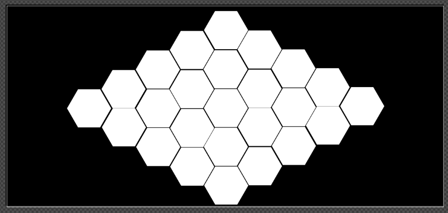

# Making blocks into a more useful audio engine
Right now, Blocks is great for doing one effect at a time. However blocks is eventually intended to allow users to make combinations of effects - using and saving configurations for later recall.

# General Goal
Allow mono and stereo effects to be combined using a hexagonally patterned grid:
- Hexagons are chosen because they have two right facing tiles that border them
- The available DSP space so to speak is a 5 wide hexagon of hexagons, shaped as below:
  - 
- Each of these hexes should only be indicated by a hashed border

## Hex Grid Combination Rules
The hex grid supports both Mono and Stereo effects with relative ease:
- Stereo effects take 1 or 2 inputs from the bordering hexes on the left, and 2 outputs to the bordering hexes on the right
- Mono effects take 1 from the cell co-linear with it, behind the spots where a stereo effect could be drawn from
  - Mono effects can also choose to output to cells directly above or below their normal inline rightward target
- Neither type takes input or output from cells that are directly above or below them

This hexagonal arrangement of Mono / Stereo effects gives many possible configurations. These three are the targetted templates for blocks' new Matrix mode:
1. 5 Inline Mono Effects (Houston parity, minus the amp stack at the end)
2. 2 rows of 4 Inline Mono Effects each, with a stereo pedal with a single input on the leftmost cell, and a stereo input pedal to combine to one output on the right
3. 3 rows of inline mono effects, with input and output stages of the following form
   - First and last hex similar to the 2 rows of 4
   - The next collumn will need two stereo effects, with the left output of the bottom, and the right output of the top summed with adjustable bias for the middle row of mono effects
   - The penultimate collumn is similar to this except in reverse