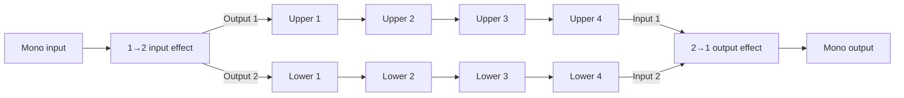

The second Matrix milestone should add a **fixed two-lane template**: one mono input feeds a 1→2 effect, its outputs pass through two independent rows of four mono effects, and a 2→1 effect combines the rows into one output.

This plan builds on the proposed [first milestone](/home/booky/Trinity%20Labs/guitarix/HEX_GRID_MILESTONE_1.md). That document is a plan; the current [audio engine](/home/booky/Trinity%20Labs/guitarix/blocks/src/audio.ts) still hosts one selected effect, so the first milestone’s model, chain runtime and preset work are prerequisites.

## Target behavior



The user can choose effects for the two boundary cells and each of the eight mono cells, edit and bypass each instance, move mono effects within or between lanes, and save or recall the complete configuration. The lane connections are fixed for this milestone.

An empty or bypassed input cell duplicates the mono signal to both lanes. An empty or bypassed output cell combines the two lanes using an equal-weight average: `0.5 × upper + 0.5 × lower`. Therefore an entirely empty template passes unity-gain mono audio. This is the default routing behavior; an active boundary effect may have different gain and channel behavior.

The generated catalogue currently has only two 1→2 entries and four 2→1 entries, including duplicate source variants and helper processors. Channel counts make them technically eligible, but do not establish that all are useful as musical splitters or combiners. The implementation should review and audition those entries, label them accurately, and keep the built-in empty-cell routing available even if the curated choice is small.

## 1. Extend the matrix model

Replace the first milestone’s single-shape `MatrixChain` with a versioned, discriminated template model. Retain its stable instance IDs, parameter values and bypass state.

```ts
type MatrixTemplate =
  | {
      kind: "inline-mono";
      slots: FiveMonoSlots;
    }
  | {
      kind: "parallel-two";
      input: MatrixInstance | null;  // 1 input, 2 outputs
      upper: FourMonoSlots;          // each 1 input, 1 output
      lower: FourMonoSlots;          // each 1 input, 1 output
      output: MatrixInstance | null; // 2 inputs, 1 output
    };
```

- Validate **exactly four** positions in each lane. Require 1→2 at the input, 1→1 in the lanes and 2→1 at the output.
- Keep instances independent of their position. Duplicate effect IDs must still have separate parameter values, bypass states and runtime nodes.
- Provide pure operations to add, replace, remove, bypass and edit instances; move mono instances within a lane or into an empty position in the other lane. Define an occupied destination as a swap so the operation never silently deletes a pedal.
- Keep boundary instances in their respective cells. They cannot be moved into mono slots because their channel contracts differ.
- Validate uniqueness of instance IDs across all ten positions. Reject unknown effect IDs, invalid channel counts, non-finite values and malformed saved data.
- Store the template kind as part of the configuration. Select the template explicitly in the Matrix page; switching templates must not silently discard unsaved work. Maintain each template’s draft separately during the session.

This stage uses fixed named positions rather than a general graph editor. The representation can later be migrated to a coordinate-based model when additional routing is implemented.

## 2. Implement explicit channel routing

Extend the first milestone’s chain runtime in [audio.ts](/home/booky/Trinity%20Labs/guitarix/blocks/src/audio.ts) or an extracted Matrix runtime.

- Keep the existing single capture stream, input trim, master controls, output protection and output routing.
- Instantiate a separate Faust node for every occupied cell. A 1→2 or 2→1 node is still created with the existing Faust runtime; its actual channel counts determine its connections.
- Route the input effect’s **first output channel to the upper lane** and **second output channel to the lower lane**. Use explicit channel splitting so browser speaker interpretation cannot reorder or downmix them.
- Connect each lane’s four 1→1 nodes serially. An empty or bypassed mono slot passes its lane through.
- Use an explicit two-channel merger to feed upper lane into output-effect input 1 and lower lane into input 2. Set channel-count and interpretation options deliberately and verify them in a real browser; do not depend on implicit Web Audio mixing.
- Ensure the output of the 2→1 stage is mono before it reaches the existing output protection and routing. System or selected stereo output may duplicate that mono result, as configured by the existing output route.
- Preserve the existing global bypass as a direct mono input-to-output path. Per-cell bypass follows the explicit pass-through rules below.

### Boundary bypass and gain

Implement the boundary cells with wet and dry branches, using short gain ramps:

| Cell   | Active                                                | Empty or bypassed                         |
| ------ | ----------------------------------------------------- | ----------------------------------------- |
| Input  | Process mono input through the selected 1→2 effect    | Copy the input at unity gain to each lane |
| Output | Feed upper and lower lanes to the selected 2→1 effect | Sum each lane at gain 0.5                 |

The equal-weight fallback prevents an empty parallel template from doubling a centered signal. Different lane processing can still produce peaks or phase cancellation; the existing master controls and output guard remain in place. Switching between an active boundary effect and its fallback can change level or phase, so crossfade the branches and test the actual transition.

As in milestone one, prepare topology changes before committing them, reject stale asynchronous requests, and retain the current audible configuration on load failure. A complete graph replacement can temporarily run up to **20 processors** during a crossfade; benchmark that case and account for processor-state and effect-tail resets. Parameter edits should target the current instance without rebuilding the entire graph.

A processor error should identify its cell and effect and stop the session using the first milestone’s failure policy. Stop, page changes and failed preparation must destroy all nodes and disconnect both lane graphs.

## 3. Extend the Matrix page

Map the template to the grid described in [BLOCKS.md](/home/booky/Trinity%20Labs/guitarix/BLOCKS.md): the leftmost boundary cell, two co-linear rows of four cells, and the rightmost boundary cell. Use dashed hexagon outlines and show the connections and signal direction.

- Label the lanes **Upper** and **Lower**, and show which boundary channel feeds each lane. Make the final mono output clear.
- Show all ten available positions, their effect names and bypass states. Empty boundary cells should indicate their built-in split or combine behavior.
- Filter each picker by its cell’s channel contract. Clearly identify 1→2 and 2→1 choices and their channel roles; do not label every catalogue match as a dedicated splitter or mixer without reviewing its behavior.
- Reuse the existing pedal controls for the selected instance. Provide explicit actions for bypass, replacement and removal.
- Offer left/right movement within a lane and a move-to-other-lane action. Communicate a swap before completing a move into an occupied cell. Provide equivalent keyboard and touch controls.
- Keep the selected instance selected after a move. Visually distinguish the selected cell, bypass state and lane without relying solely on color.
- At narrow widths, preserve the relationship between the boundary cells and both lanes through a scrollable or responsive layout. Do not collapse the two lanes into a display that implies serial processing.
- Continue to expose the first template and the single-effect workbench. Switching views or templates must use one active audio path and avoid a second capture stream.

Per-lane gain, lane mute/solo, arbitrary cross-connections and independent stereo outputs are outside this fixed template unless separately requested.

## 4. Extend presets and session restoration

Update the versioned preset service and [launcher session contract](/home/booky/Trinity%20Labs/guitarix/blocks/src/launcher.ts).

- Save the template kind, both boundary instances, the two ordered four-slot lanes, instance IDs, enabled states and parameter values.
- Migrate first-milestone five-slot presets into the `inline-mono` variant without changing their sound or slot order. Keep old single-effect launcher sessions readable as described in milestone one.
- Validate all positions against the current catalogue before loading. Identify failures by position—for example, “Lower lane, slot 3”—and leave both the current audible graph and saved preset untouched if validation or node preparation fails.
- Preserve unsaved drafts and the active template through a desktop launcher buffer restart. Loading a preset while stopped must not start audio or request microphone access.
- Keep device selections outside chain presets; a saved template describes processing, not a particular audio interface.

## 5. Test and measure

Add tests at the model, signal-routing and browser levels, then run the existing Blocks checks.

- **Model and presets:** exact lane lengths, cell eligibility, unique IDs, duplicate effects, cross-lane moves and swaps, bypass state, migration of five-slot presets, malformed data and unavailable effects.
- **Routing:** use deterministic test processors with distinguishable channel signals to verify input output 1 reaches only the upper lane, output 2 reaches only the lower lane, and lane outputs reach the correct combiner inputs.
- **Fallbacks:** verify an entirely empty template produces unity-gain mono output; bypassing the input duplicates correctly; bypassing the output averages correctly; empty and bypassed mono slots pass through.
- **Order and independence:** verify serial order separately in each lane, independent parameter changes for duplicate effects, and correct behavior after moving an instance between lanes.
- **Transitions and cleanup:** test rapid edits, failed boundary-node loading, Stop during preparation, template switches, processor errors and repeated start/stop. Confirm stale graphs cannot become active and old nodes are released.
- **Browser UI:** build and save both templates, move a pedal across lanes, recall a preset, exercise keyboard and touch-sized layouts, and confirm the correct channel-specific choices appear in each picker.
- **Regression:** run `npm run build`, `npm test` and `npm run test:browser` in `blocks/`; verify the first template, single-effect mode, setup, launcher restoration, global bypass, mute and output routing.
- **Hardware acceptance:** measure a fully populated ten-processor template and its graph transitions on the intended audio hardware. Record CPU, dropouts and measured round-trip latency against an agreed performance target. Audition the available boundary effects for useful behavior and level changes.

## Delivery order and acceptance

1. Extend the model and migrate first-milestone presets.
2. Build and verify explicit split, parallel-lane and combine routing.
3. Add template selection and the two-lane hex-grid interaction.
4. Complete persistence, launcher restoration and failure handling.
5. Run regression and real-device performance checks.

The milestone is complete when a user can configure and recall two independent four-effect mono lanes, route them through selectable 1→2 and 2→1 boundary effects, bypass or move individual effects, and hear the displayed routing reliably. An empty template must pass the original mono signal at unity gain.