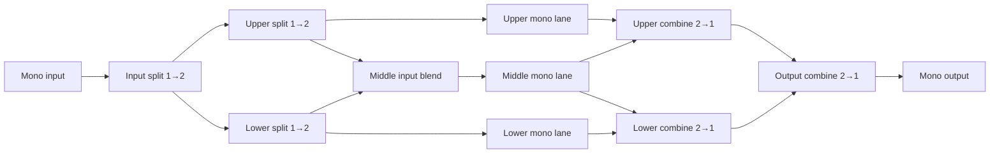

The third Matrix milestone should add a **fixed three-lane template**. A mono input is split into upper and lower signals; two further split stages create the upper, middle and lower lanes. At the other end, two combine stages reduce the three lanes to two signals, followed by a final mono output stage.

This builds on [milestone one](/home/booky/Trinity%20Labs/guitarix/HEX_GRID_MILESTONE_1.md) and [milestone two](/home/booky/Trinity%20Labs/guitarix/HEX_GRID_MILESTONE_2.md). Both are implementation plans; this stage assumes their instance model, fixed-template routing, preset handling and safe audio graph transitions have been implemented and validated.

## Target behavior



The three lanes each have **three inline mono positions**. That follows the supplied grid: the two inner split cells and two inner combine cells occupy the positions around those lanes. The user can edit and bypass all instances, move mono instances within and between lanes, adjust the middle-lane blend, and save and recall the entire template.

The routing is fixed for this milestone. The middle lane receives a blend of the inward-facing outputs of the two split stages, and its output feeds both inner combine stages. There are no direct vertical connections between neighboring hexes.

## 1. Define the routing and default behavior

Use these channel assignments consistently in the model, UI and audio tests:

| Stage          | Input and output mapping                                      |
| -------------- | ------------------------------------------------------------- |
| Input split    | Mono input → output 1 to upper split, output 2 to lower split |
| Upper split    | Output 1 → upper lane; output 2 → middle input blend          |
| Lower split    | Output 1 → middle input blend; output 2 → lower lane          |
| Upper combine  | Input 1 ← upper lane; input 2 ← middle lane                   |
| Lower combine  | Input 1 ← middle lane; input 2 ← lower lane                   |
| Output combine | Input 1 ← upper combine; input 2 ← lower combine; mono output |

All split cells accept **1→2** effects, all combine cells accept **2→1** effects, and the nine lane cells accept **1→1** effects. As in milestone two, channel counts establish compatibility but do not guarantee an effect is musically useful in a boundary position.

### Empty and bypassed cells

Use the same conventions as milestone two:

- An empty or bypassed split duplicates its mono input at unity gain to both outputs.
- An empty or bypassed combine outputs `0.5 × input 1 + 0.5 × input 2`.
- An empty or bypassed mono cell passes its input through.
- The middle input blend uses adjustable equal-sum weights: at bias `b` from 0 to 1, its output is `(1 - b) × upper inward signal + b × lower inward signal`. Default `b` is `0.5`.

The middle lane feeds both inner combine inputs at unity gain. With every cell empty or bypassed and either identical split signal reaching the middle blend, the complete template passes the input at unity gain. Different processing in the lanes can change level or cause phase cancellation; the existing output controls and protection still apply.

This plan treats the requested **adjustable bias** as the blend feeding the middle lane. The reverse side distributes the middle output equally into both combine stages. A separate adjustable output bias would be an additional control and should be specified before adding it.

## 2. Extend the matrix model

Add a third discriminated variant to the model proposed in milestone two:

```ts
type MatrixTemplate =
  | InlineMonoTemplate
  | ParallelTwoTemplate
  | {
      kind: "parallel-three";
      input: MatrixInstance | null;
      upperSplit: MatrixInstance | null;
      lowerSplit: MatrixInstance | null;
      upper: ThreeMonoSlots;
      middle: ThreeMonoSlots;
      lower: ThreeMonoSlots;
      middleInputBias: number;
      upperCombine: MatrixInstance | null;
      lowerCombine: MatrixInstance | null;
      output: MatrixInstance | null;
    };
```

- Validate exactly three positions in each lane and the channel contract of every occupied boundary cell.
- Restrict `middleInputBias` to finite values from `0` to `1`. Store it as part of the template, independent of any effect’s parameters.
- Maintain unique instance IDs across all **15 effect positions**: six boundary positions and nine mono positions. Duplicate effect IDs remain independent instances.
- Support moving mono instances within and between lanes. Moving into an occupied lane cell swaps the instances, consistent with milestone two.
- Keep split and combine instances in their compatible boundary positions. Do not allow a move that violates the channel contract.
- Keep a separate unsaved draft for each template during a session. Switching templates must not discard a draft.
- Continue using fixed template positions for this milestone. Validate the mapping to hex coordinates in one place so a later graph model can migrate saved templates deliberately.

## 3. Extend the audio engine

Add a three-lane graph builder to the Matrix runtime introduced by the earlier milestones.

- Build all split, lane, blend and combine branches using explicit channel splitting and merging. Do not rely on Web Audio’s implicit speaker mixing to assign the upper and lower channels.
- Construct the middle blend with two gain nodes whose gains sum to one. Smooth bias changes with short ramps to avoid clicks; update both gains together.
- Fan the middle lane output into the two inner combiners. Feed each combiner in the documented input order, then connect their mono outputs to the corresponding inputs of the final combiner.
- Reuse the earlier milestones’ mono slot runtime, per-cell bypass, parameter validation, processor error handling and output protection.
- Implement each boundary bypass with the explicit duplicate or average fallback above. Crossfade active and bypass branches, while recognizing that an effect can alter phase or gain.
- Prepare and validate a replacement graph before making it audible. If a node cannot load, retain the currently committed graph and report the failing cell.
- Version asynchronous changes and invalidate pending work on Stop, template changes and session teardown. Destroy all stale nodes and disconnect temporary branches.
- Apply parameter and bias changes to the active graph without rebuilding it. Topology changes may use the prior milestone’s complete-graph crossfade, subject to performance measurements.
- Account for the worst case: a fully occupied template has 15 processors, and a full old/new crossfade can temporarily run **30**. Graph replacement also resets recreated processors and may cut their tails. If that exceeds the measured audio budget, refine the transition strategy before release.

Keep the signal mono at the final template output. Existing system output routing may subsequently duplicate it to two physical output channels.

## 4. Add the three-lane Matrix view

Extend the Matrix page to show the full first-to-last routing on the supplied hex grid:

- Display the input split, two inner splits, three rows of three mono cells, two inner combiners and final output combiner. Use the dashed hexagon borders specified in [BLOCKS.md](/home/booky/Trinity%20Labs/guitarix/BLOCKS.md).
- Label the lanes **Upper**, **Middle** and **Lower**. Show the fixed connections, including both contributions to the middle input and the middle output’s two destinations.
- Place a clearly labelled **Middle input bias** control near the middle merge. Its endpoints should identify the upper and lower contributions; show the current value and allow keyboard adjustment.
- Label the fallback behavior of empty boundary cells so an empty grid still makes sense visually.
- Filter effect pickers by the selected cell’s channel counts. Reuse the existing pedal controls and independent instance state.
- Provide bypass, replace, remove, and lane-move actions with equivalent keyboard and touch operation. Preserve selection by instance ID after a move.
- Make connections and bypass status understandable without color alone. On narrow displays, use scrolling or another layout that preserves the lane relationships and makes both boundary stages reachable.
- Keep inactive templates available through the existing template selector. The first and second templates must retain their drafts and saved configurations.

## 5. Extend persistence and restoration

- Save the `parallel-three` template kind, all 15 positions, their instance state, and the middle input bias.
- Validate the saved channel contracts, unique instance IDs, parameter values and bias before preparing a recalled graph.
- Report failures by named position, such as “Lower split” or “Middle lane, slot 2.” Keep the current graph active and the saved data intact if validation or preparation fails.
- Preserve compatibility with existing first- and second-milestone presets; neither should be converted to the new template unless a future explicit conversion is designed.
- Include the active template and its unsaved draft in launcher session restoration. Restoring a draft must not itself request microphone access or start playback.

## 6. Verify the implementation

- **Model and presets:** validate three slots per lane, all boundary channel contracts, bias limits, unique instance IDs, cross-lane moves and swaps, round trips, malformed data and compatibility with earlier templates.
- **Channel routing:** use deterministic processors with distinguishable channel outputs to confirm every mapping in the routing table, including the two middle-lane sources and both middle-lane destinations.
- **Bias:** verify both endpoints and the midpoint numerically, and confirm changes do not create discontinuities beyond the chosen smoothing behavior.
- **Fallbacks:** verify unity-gain output for the entirely empty template, split duplication, combine averaging, mono pass-through and bypass behavior at every position.
- **Independence and order:** verify all three lane orders, independent settings for repeated effects and correct routing after a cross-lane move.
- **Transitions and cleanup:** exercise rapid edits, failed loads in every stage, Stop during graph preparation, processor errors, template switches and repeated session restarts. Check that stale or retired graphs are released.
- **UI:** configure all three lanes, adjust bias, move an instance across lanes, save and recall, and operate the page with keyboard and narrow touch layouts.
- **Regression and hardware:** run `npm run build`, `npm test` and `npm run test:browser`; verify the prior templates and single-effect mode. Measure a fully populated template and transition peaks on the intended audio hardware, recording CPU, dropouts and physical round-trip latency against an agreed target.

## Delivery order and acceptance

1. Add the third template model, routing contracts and preset validation.
2. Implement and test the split, middle blend, three lanes and reverse combine graph.
3. Add the full-grid UI, middle bias control and cross-lane editing.
4. Complete persistence, launcher restoration and failure handling.
5. Run regression tests and measure the fully populated graph on target hardware.

The milestone is complete when a user can build, play, edit, save and recall three independently configurable mono lanes, control the middle input blend, and hear the documented routing through the final mono output. The empty template must pass the original signal at unity gain.