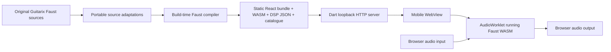
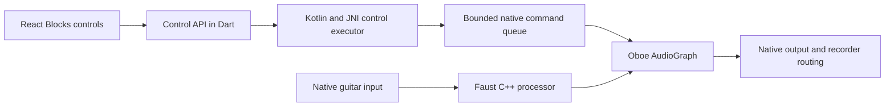

# Blocks on mobile through Dart / Flutter

Implementation handoff for `artemis_shuttle`, researched 4 November 2026.

## Recommended approach

Embed the existing Blocks production web build in a Flutter WebView, served locally from the device. Keep its existing Faust WebAssembly + AudioWorklet audio engine for the first milestone. This can deliver the actual Blocks interface and working effects without porting the Guitarix desktop application or translating its DSP into Dart.

For that milestone, give Blocks a **dedicated loopback HTTP server whose root is the complete `dist/` directory**, and present it in a dedicated Flutter screen. This avoids Blocks' absolute URL assumptions and Shuttle's fixed-size Houston iframe layout. All application assets and audio processing can remain offline.

This first milestone does **not** make the effects part of Shuttle's Oboe graph. For native guitar monitoring, recording processed guitar alongside Groovebox, or applying effects to Surge, follow with an Oboe backend built from the same adapted Faust sources. Reuse the React controls and catalogue across both backends.

The recommendation is an engineering inference from the inspected source, not a claim that either mobile platform has already been validated on hardware.

## Scope and source baseline

The investigation used these local checkouts:

| Repository | Revision inspected |
| --- | --- |
| Guitarix parent | `1d9be9cdd91654ce5a40575dc69bf86105104a07` |
| `guitarix/blocks` submodule | `94dc21f4f4233d4608acf5666735d4790bbfa9fd` |
| `../artemis_shuttle` | `9d6e71c919a5ba2d03e9821425dc6ba19be7476d` |

The requested [Trinity Labs Shuttle URL](https://github.com/Trinity-Labs-Engineering/artemis_shuttle) returned HTTP 404 to the research browser. The local sibling repository was available and is the basis for the Shuttle-specific findings. Its configured Git origin currently points to `https://github.com/MableSyrup1250/artemis_shuttle.git`; confirm the intended remote when implementing, rather than assuming both URLs identify the same revision.

No application source was changed for this investigation. The root `run.sh` was already untracked and was left untouched. Commands and interfaces proposed below are future implementation work unless explicitly identified as existing code or executed validation.

## What is already reusable

Blocks is the React app in `blocks/`, separate from the older `trunk/webui` and from the GTK/JACK desktop host.

| Existing component | What it supplies |
| --- | --- |
| `blocks/src/App.tsx` | Audio configuration, effect catalogue, filtering, parameter state, bypass/mute and playback controls |
| `blocks/src/Pedal.tsx` | Artwork and controls driven by parameter metadata |
| `blocks/src/audio.ts` | Browser capture, channel routing, Faust node loading, effect switching and output protection |
| `blocks/src/types.ts` | Effect and parameter contracts |
| `blocks/scripts/build-dsp.mjs` | Build-time Faust compilation, catalogue generation, source and notice packaging |
| `blocks/scripts/portable-sources.mjs` | Portable source tree, native lookup replacements and documented compatibility repairs |
| `blocks/public/peak-guard.js` | Finite-sample output protection worklet |
| `blocks/vite.config.ts` | Production bundling, with minification intentionally disabled |
| `blocks/docs/MILESTONE_2.md` | Catalogue boundaries, adaptation details and prior validation |

The inspected generated catalogue contains **373 source entries**, with zero recorded compilation failures. These include duplicate implementations from different source locations, helper processors and generators; this is not a claim of 373 distinct finished pedal designs.

Channel declarations in that catalogue:

| Inputs → outputs | Entries |
| --- | ---: |
| 1 → 1 | 270 |
| 2 → 2 | 88 |
| 1 → 2 | 2 |
| 2 → 1 | 4 |
| 0 → 1 | 6 |
| 4 → 2 | 1 |
| 0 → 2 | 2 |

The app auditions **one selected effect at a time**. It does not yet implement a pedal chain or arbitrary graph editor. NAM, IR convolution, Klon and other excluded native/host-dependent processors are not supplied by this browser milestone. Shuttle having NAM/IR file-management support does not make those algorithms available in Blocks.

### How its WebAssembly path works



`build-dsp.mjs` uses pinned `@grame/faustwasm` 0.19.3 / Faust 2.90.19 and `-double -ftz 2`. Runtime selection loads a precompiled `dsp.wasm` plus its `dsp.json` through `FaustWasmInstantiator.loadDSPFactory()`, then creates a worklet with `FaustMonoDspGenerator.createNode()`. Parameter addresses go to `node.setParamValue(address, value)`.

The loaded WASM binary is compiled by the WebView's WebAssembly engine; the Faust language compiler is not needed at runtime. “Mono” here refers to the Faust runtime's non-polyphonic DSP generator, not a guarantee of one input and one output. The existing app explicitly handles multiple processor inputs and stereo output. Upstream describes the library as Faust for Web Audio: [faustwasm](https://github.com/grame-cncm/faustwasm).

The app selects one browser-visible input channel and duplicates it to every DSP input. Zero-input entries are generators. Stereo output is retained, or downmixed according to the output route. A dry bypass path, input trim, output gain, compressor and ±0.95 finite-sample clamp surround the selected processor. The compressor can affect sound and latency; it is not part of the original pedal algorithm.

## What Shuttle already provides, and the gaps

| Area | Current implementation | Work for Blocks |
| --- | --- | --- |
| WebView | `lib/main.dart`, `webview_all` / `webview_all_android` 1.4.7; JavaScript enabled | Reuse dependencies; add a Blocks screen/controller |
| Local web hosting | `lib/houston_asset_server.dart`, `HttpServer.bind(loopbackIPv4, 0)` | Reuse the pattern for a dedicated root-served build |
| Existing routes | `/houston/`, `/launchpad/`, `/groovebox/`; root serves kiosk shell | Blocks is not registered |
| Shell geometry | 1560×720 iframe scaled to fit, plus `KioskViewport` 13:6 | Let Blocks see the actual device viewport |
| Microphone declaration | Android manifest already has `RECORD_AUDIO` | Add WebView capture handling and an OS permission request for this path |
| WebView capture callback | `WebViewController()` currently has no `onPermissionRequest` | Required on Android; installed plugin denies requests without a callback |
| Native permission flow | Kotlin requests microphone permission for specific recorder operations | That flow is not triggered by browser `getUserMedia()` |
| Native audio | Kotlin → JNI → Oboe `AndroidAudio` → `AudioGraph` | Separate backend; no browser-audio connection exists |
| Lifecycle | Dart restores kiosk state when resumed | Define stop/suspend and interruption handling for Blocks |
| iOS | WKWebView dependency and Runner scaffold | Add microphone usage description; verify local loading and capture on device |
| Asset types | HTTP MIME map covers JS/JSON/artwork, not `.wasm` | Add `application/wasm` to the new server |

The existing navigation delegate permits arbitrary HTTP/HTTPS destinations. A microphone-enabled Blocks screen should use a controller restricted to its bundled local application, rather than inheriting that policy unchanged.

The installed `webview_all` packages were inspected locally, rather than assuming the API of `webview_flutter` or `flutter_inappwebview`. There is no need to change WebView libraries just to attempt the first milestone.

## Choose the audio architecture explicitly

| Option | DSP location | Relationship to Oboe | Recommendation |
| --- | --- | --- | --- |
| A. Existing web build | Faust WASM in WebView AudioWorklet | Independent audio path | First milestone: highest reuse |
| B. Shared Faust source, native build | Generated C++ in Shuttle's Oboe callback | Same graph as instruments/recorder | Preferred follow-on for integrated guitar audio |
| C. Existing WASM in a native runtime | Embedded WASM interpreter/AOT runtime in C++ | Native callback invokes custom WASM host | Research option if binary reuse is a requirement |
| D. PCM bridge from Oboe through Dart/JS | WebView worklet with bridged native input/output | Two scheduling domains and extra buffering | Do not make this the initial design |

Dart is the application host and control layer in A and B. Dart compilation to WASM would not, by itself, supply browser audio APIs to native Flutter or connect Faust binaries to Oboe.

### Why the existing Oboe engine cannot simply call the browser processor

`AndroidAudio.cpp` owns Oboe streams and renders interleaved float audio in chunks of at most 256 frames. `AudioGraph.cpp` currently mixes sequencer and Surge audio, prepares recorder capture from native input/mix, runs the recorder and clamps output. Browser `AudioContext` nodes live in a separate WebView runtime and graph.

There is no existing API that exposes the WebView's AudioWorklet as a C++ `process()` callback inside that graph. Sending PCM through HTTP, MethodChannel or JavaScript messages would require queues, copying, clock reconciliation and underrun handling. At 48 kHz, a 128-frame block represents about 2.67 ms; that is not a reasonable deadline to entrust to asynchronous UI bridges. Two independent streams also do not become synchronized because both request 48 kHz.

Use bridges for effect selection, parameters, presets, routing and status. Keep audio samples entirely in the chosen audio engine.

## First milestone: run the unchanged web build

### 1. Produce a reproducible desktop build

From the Guitarix parent checkout:

```bash
git submodule update --init blocks
git -C blocks submodule update --init artemis-ui-assets
cd blocks
npm ci
npm run build
```

The documented Node minimum is 22.12. Preserve the lockfile and pinned compiler dependency. The build needs access to the parent Guitarix sources and artwork submodule; cloning the Blocks submodule alone is insufficient for rebuilding DSP.

The output is `blocks/dist/`. On the inspected build it contains **3,454 files totaling 64,102,593 bytes**, about 61.1 MiB of file content. Filesystem allocation was approximately 72 MiB. These are local measurements, not compressed APK/IPA size estimates. The `generated/` subtree accounts for 63,346,659 bytes and includes artwork, original/adapted sources and notices as well as processors.

Do not deploy `run.sh`, Vite's development server, Node, Chromium or the Faust compiler onto the phone. The root `run.sh` invokes `npm run live`; that launcher starts desktop Chromium and applies desktop audio settings. The mobile equivalent is a packaged static build loaded by the platform WebView.

### 2. Transfer the complete build into Shuttle

Suggested destination: `artemis_shuttle/blocks/ui/dist/`, or a versioned archive generated from that directory. Record the parent revision, Blocks revision, artwork revision, lockfile hash and an artifact hash alongside the build. Rebuild from source in CI or distribute an internally versioned artifact; a runtime dependency on the sibling source directory is unsuitable for an installed app.

**Flutter directory asset entries are not recursive.** Adding only `blocks/ui/dist/` would miss thousands of nested DSP, source and artwork files. Flutter requires explicit subdirectory entries: [Flutter asset documentation](https://docs.flutter.dev/ui/assets/assets-and-images).

Two practical packaging choices:

1. Generate asset declarations for every directory containing files under the copied `dist/`. Keep the Flutter asset key prefix stable and use `rootBundle.load()` just as Houston does. Do not edit the existing unrelated asset declarations away.
2. Package the complete build in one ZIP asset, declare that single file, and extract it once per artifact hash into application-support storage. Shuttle already depends on `archive` and `path_provider`. This is a convenient default for a deeply nested build.

For option 2, a build script in Shuttle could create the ZIP as follows, after `npm run build` has completed:

```python
# Future packaging helper, run from the artemis_shuttle root.
from pathlib import Path
from zipfile import ZipFile, ZIP_DEFLATED

dist = Path('../guitarix/blocks/dist').resolve()
target = Path('assets/blocks/blocks-dist.zip')
target.parent.mkdir(parents=True, exist_ok=True)
with ZipFile(target, 'w', compression=ZIP_DEFLATED) as archive:
    for file in sorted(dist.rglob('*')):
        if file.is_file():
            archive.write(file, file.relative_to(dist).as_posix())
```

Declare the resulting file under `flutter.assets`:

```yaml
    - assets/blocks/blocks-dist.zip
```

At first launch, extract to a temporary version directory, validate the file manifest/hash and expected entry points, then atomically activate that version. Reject archive paths escaping the extraction directory and links. Serve from the extracted directory without holding the whole bundle in memory. Account for the packaged archive plus extracted copy in storage estimates and remove obsolete versions when no server uses them. ZIP contents must begin at `index.html`, not at a containing `dist/` folder.

### 3. Serve Blocks at its own origin root

Proposed new file: `lib/blocks_asset_server.dart`.

Use `HttpServer.bind(InternetAddress.loopbackIPv4, 0)` and serve only the installed Blocks build. Expose the selected `http://127.0.0.1:<port>/` URI after the server starts. Do not bind to all network interfaces.

Required routes include:

| Request | File in installed build | Content type |
| --- | --- | --- |
| `/` | `index.html` | `text/html; charset=utf-8` |
| `/assets/<bundle>.js` | `assets/<bundle>.js` | `text/javascript; charset=utf-8` |
| `/assets/<bundle>.css` | `assets/<bundle>.css` | `text/css; charset=utf-8` |
| `/generated/catalog.json` | `generated/catalog.json` | `application/json` |
| `/generated/<effect-id>/dsp.wasm` | matching binary | `application/wasm` |
| `/generated/<effect-id>/dsp.json` | matching descriptor | `application/json` |
| `/generated/artwork/...` | matching artwork | correct image MIME |
| `/peak-guard.js` | `peak-guard.js` | `text/javascript; charset=utf-8` |

Support GET/HEAD, canonicalize paths inside the installed directory, return 404 for missing files and close the server when its owner is disposed. Missing `.wasm`/`.json`/`.js` must never receive an HTML SPA fallback. Set sensible content lengths and MIME types. The pinned Faust loader currently uses `fetch().arrayBuffer()` and `WebAssembly.compile()`, so it does not currently depend on streaming compilation MIME checks; correct WASM MIME remains the right server contract.

Loopback origins are considered potentially trustworthy by the [Secure Contexts specification](https://www.w3.org/TR/secure-contexts/). Verify `window.isSecureContext` and the required APIs in the actual WebView; this is a platform capability gate, not a guarantee inferred from desktop Chrome. A LAN address such as `http://192.168.x.x` is not equivalent to loopback for this purpose.

**Why `/blocks/` alone is insufficient:** `App.tsx` fetches `/generated/catalog.json`; `audio.ts` loads `/peak-guard.js`; the generated catalogue and `Pedal.tsx` use `/generated/...`; Vite's current production URLs also assume the origin root. Adding a `/blocks/` asset route without dealing with those root paths will break loading. Setting only Vite's `base` does not fix handwritten URLs or catalogue strings.

A second server avoids these collisions while preserving the Blocks source. A later shared-origin integration can explicitly make all Blocks URLs base-aware, including generated metadata and artwork, or reserve compatible root routes. Treat that as a separate change.

Do not require cross-origin isolation or SharedArrayBuffer for this first milestone: the current runtime works without them. Faust constructs worklet modules from Blob URLs; if adding a Content Security Policy, test that policy against Blob worklets and WASM compilation rather than applying a restrictive policy without verification. Keep Vite minification disabled: this build serializes Faust runtime classes into worklet source.

### 4. Add a dedicated Flutter screen

Proposed new file: `lib/blocks_screen.dart`.

Its responsibilities should be:

1. Prepare the installed artifact and start the local server.
2. Create a `webview_all` controller with JavaScript enabled and a capture permission handler.
3. Load the server root as a top-level page.
4. Give the WebView the available safe display area rather than a scaled desktop canvas.
5. Expose a Flutter-level way back to Shuttle, including when the web UI fails.
6. Stop/suspend audio and release resources on leaving the screen or interruption according to the policy below.

Register a Blocks launcher entry in Shuttle, but initially route it to this screen. Do not just add `'blocks'` to `houstonKioskShell()` and reuse its 1560×720 iframe. That would keep Blocks' responsive CSS from seeing phone dimensions and can shrink touch controls. Existing Blocks CSS and browser layout tests already cover narrow portrait and short landscape dimensions.

Android Shuttle currently locks landscape in both Dart and the manifest. Landscape is a reasonable initial constraint; portrait support also requires revisiting those host settings. If integrating into an iframe later, use real responsive dimensions and appropriate microphone Permissions Policy delegation. The top-level presentation removes that extra dependency from the first milestone.

### 5. Handle microphone permissions in both layers

On Android, there are two distinct approvals:

1. App-level `RECORD_AUDIO` runtime permission.
2. WebView approval of audio capture requested by the loaded web page.

The manifest declaration already exists, but the native recorder's Kotlin permission request is only reached by recorder commands. Blocks calls browser `getUserMedia()`, so the new path must request app permission independently or share a refactored permission service.

The installed `webview_all` 1.4.7 supports this constructor API:

```dart
final controller = WebViewController(
  onPermissionRequest: (WebViewPermissionRequest request) {
    // Dispatch to the screen's async permission coordinator.
    // It must always resolve with request.grant() or request.deny().
  },
);
```

The request exposes `types`, `grant()` and `deny()`. Check for exactly `WebViewPermissionResourceType.microphone`, request OS microphone permission on Android, and resolve the WebView request only after that result. Serialize simultaneous requests, handle activity/screen destruction and permission cancellation, and surface a recoverable explanation on denial. Do not assume the sample above implements the coordinator.

The local Android plugin implementation denies the request if no callback is installed. On WKWebView, its default is to prompt. Android documents the capture resource and advises granting only intended resources: [Android PermissionRequest](https://developer.android.com/reference/android/webkit/PermissionRequest).

One limitation of the inspected Dart wrapper: its public capture request does **not** expose the requesting origin. Its Android implementation keeps the underlying native request private. Do not write `request.origin` as though that property existed. Use a dedicated WebView containing only bundled local Blocks content and restrict navigation/frames; if per-request origin validation is required, extend the plugin to expose the native origin/frame information. Checking only `controller.currentUrl()` is not equivalent to validating an iframe's requesting origin.

The Blocks page itself should retain its user-operated **Start audio** action. Existing `audio.ts` calls `AudioContext.resume()` immediately from that gesture, before waiting for capture permission. Host-side automatic playback is unnecessary for normal startup and may fail under mobile gesture policies. Test the existing Test tone mode before asking for microphone access.

### 6. Treat iOS as a separately validated target

The inspected `ios/Runner/Info.plist` lacks `NSMicrophoneUsageDescription`; add a clear description for guitar/audio input in the implementation. WKWebView supports capture in appropriately configured host applications; see [WebKit's capture announcement](https://webkit.org/blog/11353/mediarecorder-api/) and [Apple's capture permission delegate](https://developer.apple.com/documentation/webkit/wkuidelegate/webview(_:requestMediaCapturePermissionFor:initiatedByFrame:type:decisionHandler:)).

Check the release app's local HTTP/ATS configuration on the chosen iOS version and verify loopback loading and `isSecureContext` on device. Use the narrow local-network allowance required by the actual deployment target if needed; avoid assuming Android's cleartext manifest setting applies to iOS. `NSMicrophoneUsageDescription` and local HTTP configuration solve different problems.

Validate AudioContext, AudioWorklet, Blob worklet registration, WASM, microphone prompts, wired/USB routing and interruptions on actual iPhone/iPad hardware. Oboe is Android-specific, and Shuttle's existing Dart native audio wrapper explicitly supports Android only. The first browser backend can be the iOS starting point; a later native iOS backend would use Apple's audio APIs.

### 7. Manage audio ownership, lifecycle and state

For the first milestone, stop native monitoring/capture before entering live Blocks audio. Do not assume Oboe's exclusive stream and browser capture can safely coexist or that the OS will route them identically. A simple audio-owner state such as `none | native | blocks-web` makes the transition explicit. Resume native operation only after browser capture has been released.

Foreground-only operation is a reasonable first acceptance target. Specify what happens on app backgrounding, screen exit, phone calls, audio focus loss, WebView renderer termination and USB disconnection. At minimum, release capture, stop monitoring and require an intentional restart. The existing Dart lifecycle observer only restores kiosk mode; it does not implement this policy.

Blocks currently exposes no public `window.blocksStopAudio()` or equivalent lifecycle API. `blocksRestoreSession` belongs to the desktop launcher's session-restoration mechanism. For an unchanged-build prototype, destroy/remove the dedicated page on exit and confirm capture release on each platform. For robust suspend/resume handling, add a small explicit lifecycle API in a future Blocks integration patch or in a maintained Shuttle-specific build. Do not invent a callable method that is absent from the inspected code.

Shuttle's server binds port `0`, so its origin changes after a restart. Blocks saves device/routing preferences in `localStorage`, which is scoped to origin. A dedicated server using a random port has the same persistence issue. Initially accept a fresh web configuration, or persist a versioned session in Dart and restore through a deliberately implemented API. If choosing a stable loopback port, handle port conflicts and app-instance ownership; do not silently change origin and expect stored state to follow. Do not assume every React parameter value is already persisted by Blocks.

### 8. Keep desktop latency controls out of mobile promises

The existing buffer slider depends on `window.blocksLauncher`, which the desktop launcher injects. Without it, the slider is disabled; this is expected on mobile. Do not synthesize that object just to enable a control whose behavior cannot be delivered.

Linux Chromium flags, `PULSE_PROP`, PipeWire helpers, XR18 remapping and relaunch-to-change-buffer behavior do not transfer to Android WebView/WKWebView. `latencyHint: 'interactive'` and capture latency constraints are requests, not guaranteed hardware buffer sizes. The current app does not force an AudioContext sample rate; DSP initialization must use the rate actually selected by the WebView.

The conventional 128-frame Web Audio render quantum is approximately 2.67 ms at 48 kHz. Input/output device buffering, capture processing, scheduling and the graph add latency. This is not a round-trip latency estimate. The [Web Audio specification](https://www.w3.org/TR/webaudio/) defines the processing model; device measurements determine whether the result is comfortable for guitar monitoring.

Use System default output first. `setSinkId`, selectable output devices and multichannel USB exposure vary by engine/platform. Blocks already handles lack of output selection, but an output ID saved on another platform may need resetting. Verify capture settings rather than assuming disabled echo cancellation/noise suppression/AGC were honored. Test with wired headphones or USB audio for monitoring; assess Bluetooth separately.

## Follow-on milestone: add DSP to the Oboe graph

After proving the mobile UI and catalogue, use the same Faust source inputs to build a native effects backend. Faust explicitly separates DSP generation from audio-driver/UI hosting and can produce C++: [Faust architecture documentation](https://faustdoc.grame.fr/manual/architectures/), [compiler manual](https://faustdoc.grame.fr/manual/compiler/).



### DSP generation and metadata

Start with a small allowlist such as Gain, Overdrive, Tremolo, Echo and Freeverb. Compile the **adapted** source tree supplied by `portable-sources.mjs`, not arbitrary original `.dsp` files without their compatibility dependencies. Preserve the Faust version, standard libraries, options, lookup values and provenance hashes to make browser/native comparisons meaningful.

The generated `adapted/` tree contains absolute virtual include paths. A native generation pipeline must mirror the expected virtual layout or deterministically rewrite includes to a native staging root. Adding `-I` alone does not rewrite absolute paths. The exact prepared compiler input and dependencies should be inputs to the native build cache.

Generate C++ using the pinned compiler with `-lang cpp`, a unique class name per effect and the deliberate precision/denormal options. Add the resulting processors and Faust support headers to Shuttle's existing CMake build. This is source reuse, not loading a `.wasm` file as an Android shared library.

Create an `EffectProcessor` interface with prepare/initialize, process, parameter update and channel metadata. Faust's generated C++ interface supplies operations such as `init(sampleRate)`, `buildUserInterface(...)` and `compute(count, inputs, outputs)`. Build a parameter registry off the audio thread. Preserve effect IDs and stable parameter addresses for presets, and explicitly verify path construction against the existing catalogue.

Enums/defaults need particular attention. The browser build adapts Tremolo's checkbox metadata so its third waveform is not clamped; there are also one-based enums and off-grid defaults. Native controls must use the same numeric values and ranges rather than infer semantics from a widget type.

### Concrete Oboe integration points

| File in Shuttle | Proposed responsibility |
| --- | --- |
| `android/app/src/main/cpp/CMakeLists.txt` | Compile/link generated Faust classes and a processor registry |
| `android/app/src/main/cpp/AudioGraph.h` | Own effects state and commands; preallocate processing buffers |
| `android/app/src/main/cpp/AudioGraph.cpp` | Process guitar before the selected monitor/mix/recording tap |
| `android/app/src/main/cpp/AndroidAudio.cpp` | Keep input alive for effects monitoring, handle capture status and reconfiguration |
| `android/app/src/main/kotlin/com/example/artemis_shuttle/GrooveboxAudio.kt` | Serialized off-thread construction/control, permissions and focus |
| `lib/groovebox_audio.dart` or a new effects interface | Expose effect operations through the existing `artemis_shuttle/audio` channel pattern |
| New `lib/blocks_api.dart` | Catalogue, parameter/preset and backend-status contract |
| Blocks backend adapter | Choose browser or native processing without duplicating the presentation layer |

The Kotlin files live under a `com/example/...` directory, but declare package `com.trinitylabs.artemis_shuttle`; JNI names use that actual package. Preserve this distinction when adding bindings.

Two source-specific details are easy to miss:

* `openInput()` is currently triggered by recorder operations. Guitar monitoring needs its own capture lifecycle. `pauseInputIfIdle()` currently tests only `recorder.requiresMicrophone()`; extend that ownership condition or it will stop input while effects monitoring still needs it.
* Current `AudioGraph` capture selection is tied to recorder input-source settings. Add an explicit guitar channel and wet monitoring route, and choose dry versus processed recording deliberately. Simply inserting a master-bus effect would process the sequencer/Surge mix rather than only the guitar.

Use the graph's existing bounded command/retirement queues for ownership transfer. Build, allocate, initialize and validate processors on the control executor, exchange ownership at a block boundary, and reclaim old processors off the callback. Coalesce rapid parameter changes and report queue saturation. Avoid filesystem work, network requests, Dart/JavaScript calls, locks, compiler work or heap allocation on the Oboe callback.

The native graph currently uses 48 kHz preparation and 256-frame scratch arrays; the Oboe wrapper slices callbacks to fit. Preserve that bound or generalize it consciously. Deinterleave float Oboe input into preallocated planar buffers, convert to/from the chosen Faust sample precision if necessary, and initialize DSP against the stream's actual client sample rate. Do not assume `-double` DSP buffers can alias `float*` Oboe buffers.

Handle partial/failed native input reads, input/output clock drift and stream disconnection explicitly. The current callback zeroes an input buffer and performs a nonblocking read, but does not inspect the returned frame count. Use the Oboe full-duplex patterns as a reference rather than assuming that capture code already guarantees guitar-grade operation: [Oboe FullDuplexStream](https://github.com/google/oboe/blob/main/include/oboe/FullDuplexStream.h). Low-latency callback and buffer guidance is covered by [Android's Oboe guide](https://developer.android.com/games/sdk/oboe/low-latency-audio).

Maintain click-free effect changes and parameter smoothing. Blocks currently crossfades processors over 25 ms; a native replacement should define equivalent behavior, account for overlapping DSP cost, and retain mute/output protection. An eventual pedal chain needs ordered instances and explicit channel adapters; it is additional work beyond the current single-effect audition model.

### Proposed control contract

This is a new contract, not an existing Shuttle API. It can be carried by the existing loopback HTTP pattern or a JavaScript channel for control messages only:

```json
{
  "requestId": 42,
  "method": "effects.setParameter",
  "params": {
    "instanceId": "guitar-1",
    "address": "<exact address from the generated catalogue>",
    "value": 0.5
  }
}
```

Support catalogue/capabilities, load/select, setParameter, bypass, mute, input routing, start/stop, session save/restore and status. Validate IDs, parameter ranges and finite values; version the schema. Distinguish accepted control requests from state confirmed by the audio engine. Poll or publish meters at UI rates, not once per sample block.

A future React backend interface should cover audio lifecycle, device capabilities, selecting a processor, parameters, bypass/mute/levels and meter/status snapshots. In native mode, the UI must not also start `getUserMedia()` or a browser monitoring path. Refactoring the existing `AudioEngine` boundary is necessary; this backend switch is not already implemented.

## If keeping the exact WASM binaries in Oboe is essential

An embedded native WASM runtime is possible in principle, but it is a separate host implementation. These Faust modules are not a complete portable audio device engine. The inspected `FaustWasmInstantiator.ts` supplies environment math imports, memory/table setup, DSP instance layout, sample buffers and parameter mapping.

A native host would need to inspect and satisfy each module's imports/exports, implement the Faust ABI and JSON parameter-offset semantics, manage memory alignment and precision, compile/instantiate off the audio callback, and demonstrate bounded execution on Android ABIs. Check whether each import invokes host math code and include that cost in profiling. An interpreter/AOT choice, memory-growth policy, runtime footprint, licensing and platform distribution support all need validation.

The existing `tests/dsp.test.mjs` provides useful numerical test vectors and demonstrates offline factory creation, but its JavaScript runtime is not a drop-in C++ host. Choose this option only if distributing the same binary module across hosts has enough value to justify the additional runtime and real-time validation. Native Faust C++ is the more direct fit for Shuttle's existing C++ graph.

## Implementation sequence and acceptance criteria

| Stage | Work | Acceptance gate |
| --- | --- | --- |
| 1. Package and display | Versioned complete build, local server, dedicated screen | Catalogue, artwork and controls work with network disabled |
| 2. Browser playback | Feature probe, user gesture, Test tone, protected output | At least Gain/Overdrive/Echo/Reverb load and change the signal without processor errors |
| 3. Live mobile capture | Both permission layers, device defaults, lifecycle | Wired/USB guitar input works; denial and exit release resources |
| 4. Measure suitability | Latency, CPU, thermal and interruption tests | Written device results meet the product's chosen monitoring target |
| 5. Native pilot | Small Faust C++ set in Oboe, same control schema | Guitar processing and recording work in one native graph |
| 6. Expand | More effects, presets, then optional chains/NAM/IR | Per-feature correctness and performance gates |

Recommended implementation changes for stages 1–3 belong mainly in Shuttle: packaging helper, ZIP asset declaration, artifact installer, Blocks server/screen, launcher entry, microphone coordinator, navigation and lifecycle handling, plus iOS configuration. The initial Blocks artifact can remain unchanged. Better lifecycle hooks, Dart-backed session persistence and a native backend are later, explicit changes to the Blocks integration build.

### Device validation checklist

* Record OS, device, Android System WebView/iOS version, app build and audio interface.
* Probe `window.isSecureContext`, `WebAssembly`, `AudioContext`, `AudioContext.audioWorklet` on a constructed context, and `navigator.mediaDevices.getUserMedia`. Test Blob registration as well as `/peak-guard.js`.
* Confirm the production bundle works offline; every catalogue WASM/JSON/source and artwork reference resolves, with correct MIME types and no HTML fallback.
* Test first grant, denial, permanent denial, later settings grant and cancellation during pending permission.
* Verify Test tone does not capture input, Stop releases capture, and entering/leaving Blocks does not leave simultaneous native/browser monitoring.
* Test mono input duplication, stereo effects, downmix, generators, parameter extrema, bypass/mute and rapid effect switching.
* Exercise narrow phones, short landscape displays, tablets, safe areas and real touch controls. Desktop viewport emulation alone is insufficient.
* Test app background/foreground, calls/audio focus loss, USB removal, route changes and WebView recreation. Require a clear recovery path.
* Measure physical round-trip latency with a known pulse/loopback setup, reporting method, median and worst case. Do not substitute `baseLatency`, `outputLatency` or requested buffer frames for a measurement.
* Run sustained sessions through expensive reverbs and rapid UI interaction; record underruns/dropouts, thermal behavior, memory and power use. Test native/browser parity separately if adding C++.

For diagnosing silence, inspect in this order: static route status/MIME, secure context/APIs, OS permission, WebView capture permission, AudioContext state, processor errors, input channel/route, output mute/gain and OS output route. This separates packaging failures from audio-engine failures.

## Distribution materials

Keep the existing `COPYING`, `THIRD_PARTY_NOTICES.md`, source declarations and shipped original/adapted source materials with the artifact and its reproducible source release. The Blocks package declares GPL-2.0-or-later; its notices identify the faustwasm runtime as LGPL-2.1 and distinguish individual Faust source notices. The attached artwork revision has no standalone licence file according to the existing notices. Establish the intended artwork distribution permission before shipping it beyond the current project context.

Do not assume WebView packaging or a process boundary changes applicable distribution terms. Use the repository's existing notices as implementation inputs when preparing a release; this report does not determine the legal status of a combined application.

## Validation performed during this investigation

The existing generated production artifact was inspected without rebuilding it. All 373 catalogue entries have existing WASM, JSON and source targets in `dist/`; the catalogue records no compile failures. Build size and channel counts above were calculated directly from this artifact.

Four existing Playwright tests were run against the production build and passed: mobile controls fit, mobile setup/denied channel checks recover, first launch does not capture automatically and setup remains accessible during playback, and permission denial leaves audio stopped. These used desktop Chromium with the repository's fake-media/headless configuration, not Android WebView or WKWebView.

The existing non-browser DSP/catalogue/lookup/guard suite was also run directly against generated assets using `node --test tests/*.test.mjs`: **394 passed, zero failed or skipped**, in approximately 51 seconds. No mobile device, Flutter release build, real guitar interface or physical latency measurement was available in this investigation.

## Local source references

Paths below are relative to the Guitarix parent unless prefixed with `../artemis_shuttle/`:

* [Blocks overview](../blocks/README.md), [milestone details](../blocks/docs/MILESTONE_2.md), [third-party notices](../blocks/THIRD_PARTY_NOTICES.md).
* [Browser audio engine](../blocks/src/audio.ts), [React application](../blocks/src/App.tsx), [pedal controls](../blocks/src/Pedal.tsx), [metadata types](../blocks/src/types.ts).
* [DSP build pipeline](../blocks/scripts/build-dsp.mjs), [portable sources](../blocks/scripts/portable-sources.mjs), [Vite configuration](../blocks/vite.config.ts), [DSP tests](../blocks/tests/dsp.test.mjs).
* Shuttle: `lib/main.dart`, `lib/houston_asset_server.dart`, `lib/kiosk_viewport.dart`, `lib/groovebox_audio.dart`, `pubspec.yaml`.
* Shuttle Android: `android/app/src/main/AndroidManifest.xml`, `android/app/src/main/cpp/{AndroidAudio.cpp,AudioGraph.h,AudioGraph.cpp,CMakeLists.txt}`, `android/app/src/main/kotlin/com/example/artemis_shuttle/{MainActivity.kt,GrooveboxAudio.kt}`.
* Shuttle iOS: `ios/Runner/Info.plist`, `ios/Runner/AppDelegate.swift`.
* Installed WebView API inspected: `~/.pub-cache/hosted/pub.dev/webview_all-1.4.7/lib/src/webview_controller.dart` and the corresponding `webview_all_android-1.4.7` / `webview_all_wkwebview-1.4.7` controller implementations.
